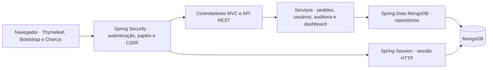

# Pediu Patrão — Sistema de Gestão de Pedidos e Auditoria


O **Pediu Patrão** é uma solução para gestão operacional de pedidos em estabelecimentos alimentícios (pizzarias e restaurantes). O sistema foi projetado com uma arquitetura robusta baseada em **Spring Boot**, **MongoDB** e **Thymeleaf**, focando na aplicação rigorosa de **Controle de Acesso Baseado em Papéis (RBAC)** no backend, **Máquina de Estados para Pedidos**, otimização da fila de atendimento e **Auditoria Imutável e Persistente** para conformidade e rastreabilidade de operações sensíveis.

---

## Sumário

- [Arquitetura](#arquitetura)
- [Tecnologias utilizadas](#tecnologias-utilizadas)
- [Requisitos do sistema de pedidos](#requisitos-do-sistema-de-pedidos)
- [Ambiente de teste](#ambiente-de-teste)
- [Contas e permissões](#contas-e-permissões)
- [Roteiro de verificação](#roteiro-de-verificação)
- [Estrutura do projeto](#estrutura-do-projeto)
- [Segurança e conformidade](#segurança-e-conformidade)
- [Dashboard administrativo](#dashboard-administrativo)

## Arquitetura



- O Thymeleaf renderiza o layout e o JavaScript consulta o resumo em JSON para preencher indicadores, gráfico e ranking.
- Os controladores recebem as requisições. O `DashboardService` consolida as vendas, os status e os produtos a partir dos pedidos consultados pelo repositório.
- O Spring Security verifica a sessão e o perfil antes de liberar a página ou a API. O Spring Session guarda a sessão HTTP no mesmo banco configurado para a aplicação.
- O MongoDB armazena pedidos, clientes, usuários, produtos, auditoria e sessões. A fila exibe até seis finalizados recentes e o banco preserva o histórico para o painel.
- A preferência de tema fica no navegador e se aplica às telas que usam o layout compartilhado.

## Tecnologias utilizadas

| Camada | Tecnologia |
| --- | --- |
| Aplicação | Java 21 e Spring Boot 3.4.4 |
| Interface | Thymeleaf, Bootstrap 5.3, Bootstrap Icons e Chart.js |
| Segurança | Spring Security, BCrypt e proteção CSRF |
| Dados e sessões | Spring Data MongoDB e Spring Session |
| Compilação e execução | Maven Wrapper |


## Requisitos do sistema de pedidos

| ID | Requisito |
| --- | --- |
| RF01 | Autenticar usuários e aplicar permissões para os perfis ADMIN, GERENTE e ATENDENTE. |
| RF02 | Cadastrar pedidos com cliente, sabor, tamanho, quantidade e valores. |
| RF03 | Acompanhar os estados RECEBIDO, PREPARANDO, PRONTO, A_CAMINHO, FINALIZADO e CANCELADO. A fila mantém até seis finalizados visíveis e o banco preserva o histórico. |
| RF04 | Aplicar desconto de até 20% no formulário e registrar a justificativa do cancelamento na auditoria. |
| RF05 | Consultar eventos de auditoria, incluindo alterações de estado, cancelamentos e mudanças de cadastro registradas pelo sistema. |

Os requisitos específicos do dashboard estão na [seção do painel](#dashboard-administrativo).


## Ambiente de teste

### 1. Pré-requisitos

- JDK 21 configurado no `JAVA_HOME`. Confira com `java -version` e `.\mvnw.cmd -v`.
- MongoDB Community Server e MongoDB Shell (`mongosh`) disponíveis no Windows. O servidor é necessário para o banco local. O shell é usado apenas para inserir os dados fictícios do passo 4.
- PowerShell e um navegador. O Maven Wrapper baixa as dependências no primeiro uso.

Se você já baixou o repositório, abra o terminal na pasta que contém `pom.xml` e `mvnw.cmd`. Para obter uma cópia nova do código, clone o repositório e selecione a branch em que o dashboard está disponível.

```powershell
git clone https://github.com/bielxcesar/pediuPatrao_UMC.git
cd pediuPatrao_UMC
```

### 2. Iniciar o MongoDB de teste

No **primeiro terminal**, crie uma pasta local para o banco e inicie o MongoDB na porta `27028`. Os dados ficam separados do banco padrão.

```powershell
$pastaDados = Join-Path $env:LOCALAPPDATA 'PediuPatrao\mongo-teste'
New-Item -ItemType Directory -Force -Path $pastaDados | Out-Null
mongod --dbpath $pastaDados --bind_ip 127.0.0.1 --port 27028
```

Se `mongod` não estiver no PATH, execute o `mongod.exe` da pasta `bin` da instalação ou do pacote portátil, usando os mesmos argumentos. Mantenha o terminal aberto enquanto usa o sistema. Se já existe um MongoDB de teste na porta `27028`, reutilize a instância.

### 3. Iniciar a aplicação

No **segundo terminal**, na pasta do `pom.xml`, configure o banco, a porta e, se o banco for novo, a senha inicial. A senha deve ter pelo menos 12 caracteres e até 72 bytes em UTF-8.

```powershell
$env:MONGODB_URI = 'mongodb://127.0.0.1:27028/pediu_dashboard_teste'
$env:SERVER_PORT = '8080'
$env:PEDIU_ADMIN_PASSWORD = [System.Net.NetworkCredential]::new('', (Read-Host 'Senha inicial do admin' -AsSecureString)).Password
.\mvnw.cmd clean spring-boot:run
```

Se o banco já tiver um administrador, a aplicação mantém a conta e a senha existentes. Na IDE, configure as mesmas variáveis na configuração de execução e execute `com.umc.pediupatrao.PizzariaPedidosApplication`. O Spring lê as variáveis do processo.

Abra [localhost:8080/login](http://localhost:8080/login) e entre como `admin`. Se estiver usando temporariamente o JDK 17, execute `.\mvnw.cmd '-Djava.version=17' clean spring-boot:run`. O `clean` recompila classes que possam ter sido geradas com outro JDK.

| Variável | Uso | Padrão |
| --- | --- | --- |
| `MONGODB_URI` | Endereço e banco usados pela aplicação | `mongodb://localhost:27017/pizzaria_db` |
| `SERVER_PORT` | Porta HTTP da aplicação | `8080` |
| `PEDIU_ADMIN_PASSWORD` | Senha para criar o primeiro administrador | Sem valor padrão |

### 4. Carregar pedidos fictícios

No **terceiro terminal**, conecte o shell ao banco de teste:

```powershell
mongosh "mongodb://127.0.0.1:27028/pediu_dashboard_teste"
```

No prompt do `mongosh`, execute o bloco abaixo. Ele cria ou atualiza apenas os três pedidos fictícios identificados pelos IDs `demo-dashboard-1`, `demo-dashboard-2` e `demo-dashboard-3`. Os pedidos são datados no dia da carga para aparecerem no filtro inicial.

```javascript
const hoje = new Date();

[
  { _id: "demo-dashboard-1", status: "FINALIZADO", sabor: "Calabresa", quantidade: 2, valorTotal: "90.00" },
  { _id: "demo-dashboard-2", status: "FINALIZADO", sabor: "Muçarela", quantidade: 1, valorTotal: "45.00" },
  { _id: "demo-dashboard-3", status: "RECEBIDO", sabor: "Frango", quantidade: 1, valorTotal: "50.00" }
].forEach(({ _id, ...pedido }) => {
  db.pedidos.updateOne(
    { _id },
    { $set: { ...pedido, clienteNome: "Cliente fictício", dataHoraEntrada: hoje } },
    { upsert: true }
  );
});
```

Em um banco de teste vazio, o dashboard mostrará **3 pedidos, 2 finalizados, R$ 135,00 de faturamento e R$ 67,50 de ticket médio**. Calabresa ficará em primeiro no ranking, com duas unidades. Esses dados de reprodução são menores que o conjunto usado nas evidências da entrega.

## Contas e permissões

Entre como administrador e abra **Gestão de Usuários → Novo Usuário** para criar uma conta de gerente e outra de atendente. Defina senhas próprias para os testes.

| Perfil | Dashboard e API de resumo | Gestão de usuários |
| --- | --- | --- |
| ADMIN | Sim | Sim |
| GERENTE | Sim | Sem acesso |
| ATENDENTE | Sem acesso | Sem acesso |
| Visitante | Redirecionado ao login | Redirecionado ao login |

O cadastro e a alteração de perfis são exclusivos de administradores. A sessão HTTP é persistida no MongoDB e expira após 30 minutos de inatividade. O logout invalida a sessão. Em **Configurações → Aparência**, escolha o tema claro ou escuro. A preferência fica salva neste navegador.

## Roteiro de verificação

1. Entre como administrador ou gerente e abra **Dashboard**. Confira os cartões, o gráfico, a situação dos pedidos e o ranking.
2. Aplique um intervalo de datas que inclua o dia da carga. Depois, clique em **Atualizar** para consultar novamente o mesmo período.
3. Consulte uma data sem pedidos e verifique os indicadores zerados. Inverta as datas para conferir a mensagem de validação.
4. Na mesma sessão, abra a [API de resumo](http://localhost:8080/api/dashboard/resumo) em outra aba e confira o JSON.
5. Entre como atendente em uma janela privativa e tente abrir `/admin` e `/api/dashboard/resumo` diretamente. O acesso deve retornar HTTP 403.
6. Em **Configurações → Aparência**, selecione o tema escuro. Volte ao painel e recarregue a página para conferir se a escolha foi mantida.


## Estrutura do projeto

```text
src/main/java/com/umc/pediupatrao/
├── config/                  # Configurações do Spring Security (SecurityConfig, BCrypt)
├── controller/              # Controladores Web (PedidoController, UsuarioController, AuditoriaController)
├── entity/                  # Documentos MongoDB (Pedido, Cliente, Usuario, Auditoria)
│   └── enums/               # Enumeradores de domínio (RoleEnum, StatusPedidoEnum)
├── repository/              # Repositórios Spring Data MongoDB
└── service/                 # Camada de Serviços, Regras de Negócio e Auditoria
```

---

## Segurança e conformidade

* **Proteção CSRF:** Habilitada em todas as requisições de formulários Thymeleaf.
* **Hash de senhas:** Senhas armazenadas no banco utilizando o algoritmo `BCryptPasswordEncoder`.
* **Sanitização de Auditoria:** Credenciais, senhas e tokens nunca são persistidos na coleção de logs de auditoria.
* **Isolamento do Git:** O arquivo `.gitignore` previne a inclusão acidental de arquivos `.env`, configurações da IDE (`.idea/`) e artefatos compilados (`target/`).

## Dashboard administrativo

No menu lateral, abra **Dashboard** ou acesse a rota `/admin`. Somente usuários autenticados com perfil **ADMIN** ou **GERENTE** podem abrir a tela e consultar a API. O servidor aplica a restrição também no acesso direto.

### Requisitos funcionais

| ID | Critério de aceitação |
| --- | --- |
| RF01 | Exibir faturamento líquido, ticket médio, total de pedidos e pedidos finalizados no período. |
| RF02 | Apresentar série diária de faturamento, incluindo dias sem vendas, e tabela com os valores do gráfico. |
| RF03 | Exibir contagens por status atual, incluindo cancelados. A fila de atendimento mantém até seis finalizados visíveis e preserva o histórico no banco. |
| RF04 | Classificar até dez produtos por quantidade vendida em pedidos finalizados. |
| RF05 | Consultar intervalo de datas inclusivo. Abrir com os últimos 30 dias e validar intervalos de até 366 dias. |
| RF06 | Alimentar o painel com o resumo JSON do MongoDB, usando a sessão do sistema. |
| RF07 | Reconsultar ao aplicar filtros ou clicar em Atualizar e indicar carregamento, ausência de pedidos, erro e sessão expirada. |

### Requisitos não funcionais

| ID | Critério de aceitação |
| --- | --- |
| RNF01 | Restringir a tela e a API aos perfis ADMIN e GERENTE no servidor. |
| RNF02 | Expor somente dados consolidados e impedir o armazenamento da resposta em cache. |
| RNF03 | Usar filtros rotulados, mensagens anunciadas por leitores de tela e tabela equivalente ao gráfico. |
| RNF04 | Preservar precisão monetária com BigDecimal e arredondar o ticket médio a duas casas. |
| RNF05 | Reaproveitar Spring Boot, Thymeleaf e o modelo de pedidos MongoDB, incluindo a leitura do formato antigo por sabor. |

### Arquitetura e regras de negócio

O navegador faz uma consulta por atualização. O controlador valida as datas, o repositório lê pedidos do intervalo e o serviço monta o resumo. Uma consulta única mantém indicadores e gráficos no mesmo recorte de pedidos. O sistema reconhece a venda quando o pedido está finalizado e agrupa o valor pela data em que o pedido entrou. O histórico disponível começa nos pedidos ainda presentes no banco.

### API do dashboard

#### GET /api/dashboard/resumo

Usa a sessão do Pediu Patrão e requer perfil ADMIN ou GERENTE. Envia os dados consolidados em JSON, com Cache-Control no-store. Cada consulta lê o período no MongoDB.

| Parâmetro | Formato | Padrão |
| --- | --- | --- |
| inicio | AAAA-MM-DD | 29 dias antes de fim |
| fim | AAAA-MM-DD | Data atual em America/Sao_Paulo |

As duas datas são inclusivas e o período pode ter até 366 dias. O período se refere à data de entrada do pedido. Seu status atual define a situação e a inclusão nos indicadores de vendas. Somente os finalizados entram no faturamento (valor total após descontos), no ticket médio e no ranking. Valores ausentes em pedidos finalizados contribuem com zero para o faturamento. O ticket divide o faturamento pelo número de finalizados e arredonda para duas casas decimais.

O gráfico inclui dias com faturamento zero. O ranking lista até dez produtos por unidades vendidas. Pedidos antigos sem itens usam o sabor registrado no pedido como categoria própria. Pedidos antigos sem status são contados separadamente em pedidosSemStatus. Pedidos excluídos antes da preservação do histórico ficam fora dos indicadores.

#### Exemplo

```http
GET /api/dashboard/resumo?inicio=2026-11-09&fim=2026-11-09
```

```json
{
  "inicio": "2026-11-09",
  "fim": "2026-11-09",
  "totalPedidos": 2,
  "pedidosFinalizados": 1,
  "faturamento": 48.90,
  "ticketMedio": 48.90,
  "situacao": {
    "RECEBIDO": 1,
    "PREPARANDO": 0,
    "PRONTO": 0,
    "A_CAMINHO": 0,
    "FINALIZADO": 1,
    "CANCELADO": 0
  },
  "pedidosSemStatus": 0,
  "vendasDiarias": [{"data": "2026-11-09", "faturamento": 48.90}],
  "produtosMaisVendidos": [{"produtoId": "p123", "nome": "Pizza Margherita", "quantidade": 1}]
}
```

| HTTP | Condição |
| --- | --- |
| 200 | Consulta válida, inclusive para períodos vazios |
| 302 | Sessão ausente ou expirada, com redirecionamento para o login |
| 400 | Data inválida, período invertido ou acima do limite. O corpo contém status e detail |
| 403 | Sessão autenticada sem permissão para o dashboard |
| 500 | Falha inesperada durante a consulta |

### Evidências de teste

Execução em 10/11/2026 com Edge, Spring Boot 3.4.4 e MongoDB Community 7.0.45 local. A validação usou Java 17 por meio de uma opção temporária do Maven. O projeto declara JDK 21.

| Cenário | Resultado observado |
| --- | --- |
| Consulta de 1 a 10 de novembro | HTTP 200, Cache-Control no-store, 10 pedidos, 8 finalizados, R$ 600,00 de faturamento e R$ 75,00 de ticket médio. |
| Gráfico, situação e ranking | Série com 10 dias, zero em dia sem vendas, 1 recebido, 1 cancelado e Pizza Calabresa no topo com 18 unidades. |
| Fila de atendimento | Após abrir a fila, os 8 finalizados continuam no resumo histórico da API. |
| Atualizar período sem pedidos | Consulta concluída e mensagem de período vazio com indicadores zerados. |
| Datas inválidas | Formulário mostra a mensagem de validação para período invertido. Data malformada retorna HTTP 400. |
| Acesso | Visitante recebe redirecionamento ao login. Gerente recebe HTTP 200. Atendente recebe HTTP 403 na tela e na API. |

- [Painel com pedidos fictícios](evidencias/dashboard-com-vendas.png)
- [Resposta do endpoint](evidencias/resposta-api.png)
- [Período vazio](evidencias/periodo-vazio.png)
- [Intervalo inválido](evidencias/periodo-invalido.png)
- [Vídeo de demonstração com capturas legendadas](dashboard-demonstracao.mp4)
